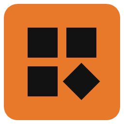
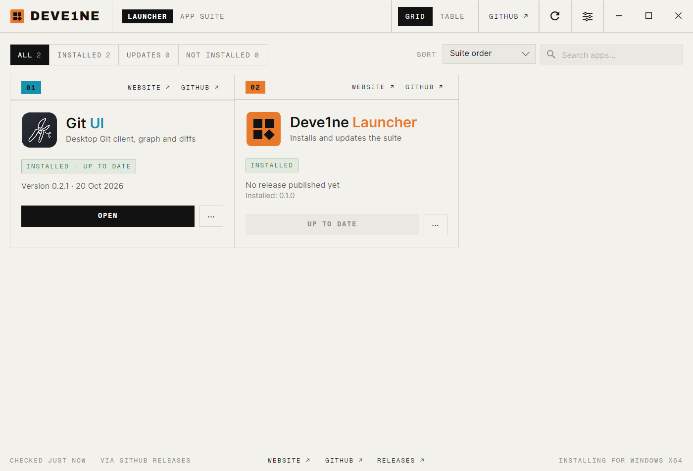
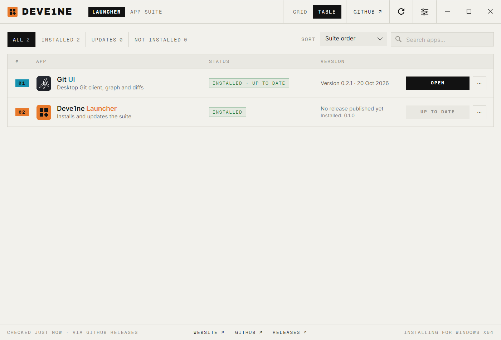

<div align="center">



# Deve1ne Launcher

**One place to install, update and open every Deve1ne app.**


[](LICENSE)
[](https://github.com/Deve1ne/deve1ne-launcher/releases/latest)

**[Download](https://github.com/Deve1ne/deve1ne-launcher/releases/latest)** · [Apps](#the-apps) · [How it works](#how-it-works) · [Add an app](#add-an-app)



</div>

---

## What it does

- **Every app on one page.** A card per app: its status (available, installed, update available),
  the latest version and its date, and one button that installs, updates or opens it.
- **Always the latest build.** Each app's latest GitHub release is checked when the launcher
  opens and every hour while it stays open.
- **Safe downloads.** Every file is checked against the `SHA256SUMS.txt` published with its
  release before anything is installed.
- **No administrator rights.** Apps install for the current user; an open app is asked to close
  (and save its session) before it is updated.
- **Updates itself.** The launcher is one of the apps: a new release replaces it and restarts it.
- Grid or table view, filters (all, installed, updates, not installed), sort and search.



## The apps

| # | App | Repository |
|---|---|---|
| 01 | **Git UI**: a fast desktop Git client with a readable commit graph | [Deve1ne/git-ui](https://github.com/Deve1ne/git-ui) |
| 02 | **Deve1ne Launcher**: this app | [Deve1ne/deve1ne-launcher](https://github.com/Deve1ne/deve1ne-launcher) |

## Install

Download `Deve1ne-Launcher-<version>-win-x64.exe` from the
**[latest release](https://github.com/Deve1ne/deve1ne-launcher/releases/latest)** and run it. It copies
itself to `%LocalAppData%\Programs\Deve1ne Launcher`, adds a Start menu shortcut and an entry in
*Settings > Apps*, then opens. Uninstalling it there leaves the apps it installed in place.

The executable is not code-signed yet, so Windows SmartScreen asks for a confirmation the first time
(*More info* > *Run anyway*).

## How it works

```
src/Deve1ne.Launcher/
  Core/         the catalog, GitHub release parsing, versions, checksums, app states (no UI, tested)
  Platform/     GitHub client, Windows Installer (msi.dll, msiexec), self-install and self-update
  ViewModels/   a card per app, the window (filters, sort, search, checks)
  Views/        Avalonia UI: custom title bar, grid and table views
tests/          xUnit tests of Core
```

- **Check**: `GET /repos/{owner}/{repo}/releases/latest` for each app's repository, all at once.
- **Installed version**: MSI apps are found through their upgrade code (`MsiEnumRelatedProducts`);
  the launcher reads its own version.
- **Install / update**: download the release asset, verify its SHA-256, close the running app,
  `msiexec /i <file> /qn`. Logs go to `%LocalAppData%\Deve1ne\Launcher\logs`.
- **Self-update**: the running executable is renamed aside, the new one takes its place and starts.

## Add an app

1. Publish releases in the app's repository with a Windows asset whose name contains the version
   (for example `MyApp-1.2.0-win-x64.msi`) and a `SHA256SUMS.txt` that lists it. A per-user MSI
   is expected for now.
2. Add an entry to [`SuiteCatalog`](src/Deve1ne.Launcher/Core/SuiteCatalog.cs): number, name,
   accent color, repository, asset pattern, MSI upgrade code, install folder and executable.
3. Add its icon as `src/Deve1ne.Launcher/Assets/apps/<id>.png` (256 x 256).

## Build from source

```bash
git clone https://github.com/Deve1ne/deve1ne-launcher.git
cd deve1ne-launcher
dotnet test
dotnet run --project src/Deve1ne.Launcher -- --portable
```

`--portable` runs the launcher where it is, without installing itself. Releases are built by
[release.yml](.github/workflows/release.yml): pushing a tag such as `v0.1.0` tests, builds the
single-file executable and publishes it with its checksum.

## License

Deve1ne Launcher is free software: you can redistribute it and/or modify it under the terms of the
[GNU General Public License](LICENSE) as published by the Free Software Foundation, either version 3
of the License, or (at your option) any later version. It is distributed in the hope that it will
be useful, but WITHOUT ANY WARRANTY.

Bundled fonts, under the SIL Open Font License: [Geist Mono](src/Deve1ne.Launcher/Assets/fonts/OFL-GeistMono.txt)
and [Archivo](src/Deve1ne.Launcher/Assets/fonts/OFL-Archivo.txt). The look is inspired by the
ArtCraft Launcher.

© 2026 Dimitri Even

---

<div align="center"><sub>Made by <a href="https://github.com/Deve1ne">Deve1ne</a></sub></div>
